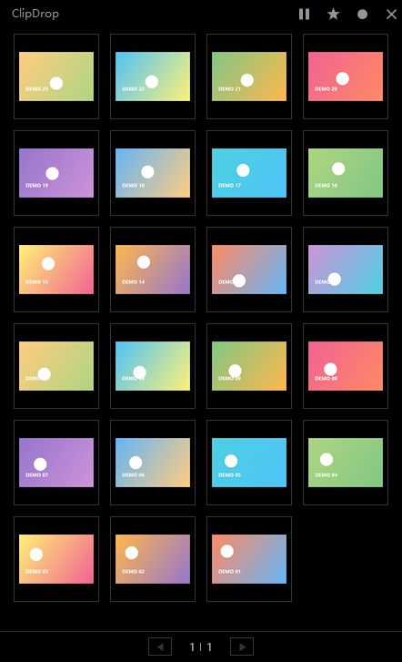
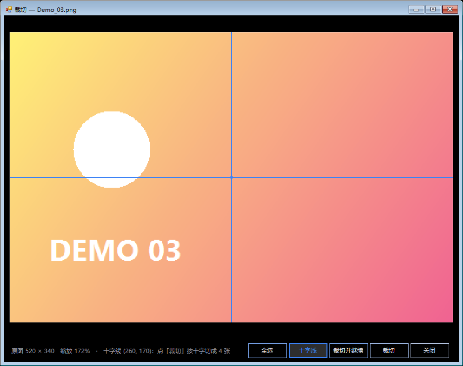
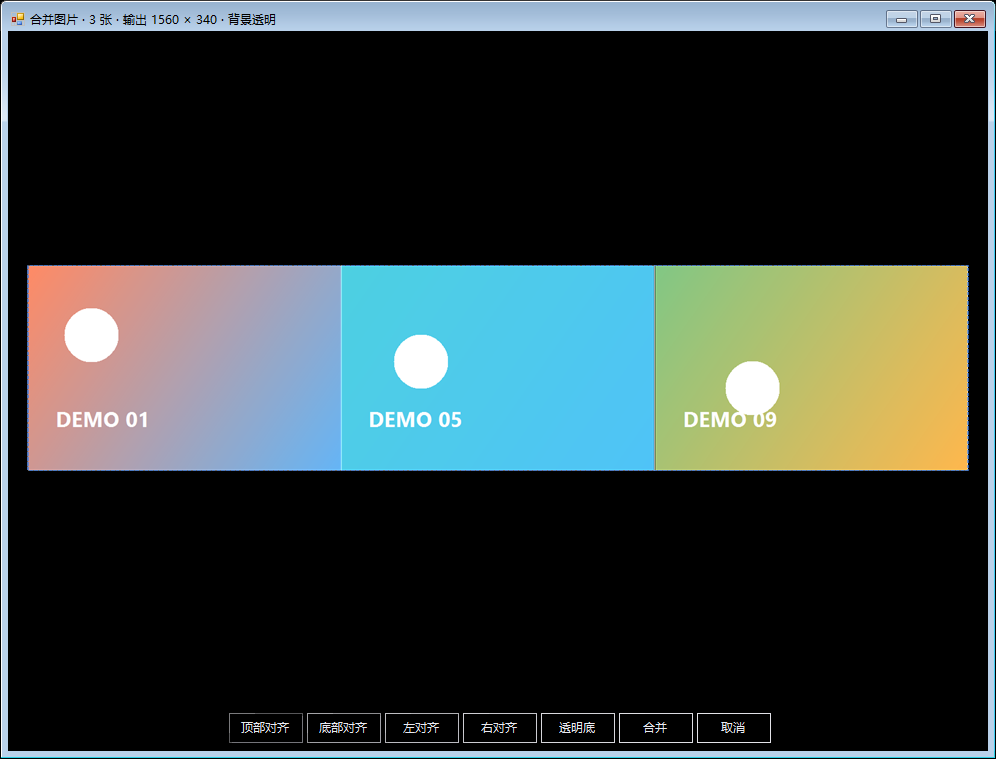
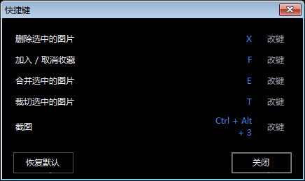

# ClipDrop

一个 Windows 下的小工具：**粘贴即存**的图片暂存画板。
把截图/复制的图片直接粘进来，它会自动保存到指定文件夹并排成画板，随时拖出去用（扔进 Tripo、浏览器、聊天窗口等）。

深色界面、单文件 C# / WinForms 实现、无第三方依赖。

> 作者：**huiyingtang** · GitHub：[@Huiyingtang](https://github.com/Huiyingtang)

## 界面

<p align="center">
  
</p>

## 功能

- **粘贴即存**：监听剪贴板，`Ctrl+Alt+V` 或复制图片后自动保存到当前画板文件夹（自动按时间命名 `Paste_yyyyMMdd_HHmmss_fff.png`，自动去重）
- **画板网格**：缩略图分页展示，文件夹里有几百张也流畅（缩略图渐进解码，未加载完显示格式占位块）
- **拖出使用**：把缩略图直接拖到其他程序里即可（拖拽的是真实文件）
- **收藏**：按 `F` 收藏 / 取消收藏；点星标只显示收藏的图片，收藏记录按文件夹分别保存
- **删除进回收站**：按 `X` 删除选中图片（进回收站，可从回收站还原）；「清理未收藏」批量清理文件夹里未收藏的图片
- **导出已收藏**：右键菜单一键把当前文件夹收藏的图片复制到指定文件夹
- **裁切（T）**：拖拽选区裁切，支持滚轮缩放 / 右键平移；「十字裁切」沿十字线一键把图切成 4 张（十字线可拖动定位）
- **合并（E）**：多选图片合并成一张，拖动时可自动吸附对齐，四角拖动可按比例缩放；「顶部/底部/左/右对齐」都是无缝紧贴
- **截图（Alt+3）**：全屏遮罩 + 十字光标，框选区域后自动保存到当前画板并复制到剪贴板（可直接在别处 `Ctrl+V`）
- **其它**：窗口置顶 / 透明度 / 背景色可调、开机自启、可收起成悬浮小球、所有快捷键可改键

## 操作截图

裁切（十字线模式）：

<p align="center">
  
</p>

合并（紧贴对齐 + 吸附辅助线）：

<p align="center">
  
</p>

快捷键设置（全部可改键）：

<p align="center">
  
</p>

## 默认快捷键

| 按键 | 功能 |
| --- | --- |
| `Ctrl+Alt+V` | 手动保存剪贴板图片 |
| `Alt+3` | 屏幕截图（框选后保存并复制到剪贴板） |
| `X` | 删除选中图片（进回收站） |
| `F` | 收藏 / 取消收藏 |
| `E` | 合并选中图片 |
| `T` | 裁切选中图片 |
| 鼠标右键 | 空白处 / 缩略图上弹出对应菜单 |
| 鼠标滚轮 | 翻页 |

所有按键都能在「右键菜单 → 快捷键」里重新绑定。

## 使用方法

1. 运行 `ClipDrop.exe`，第一次启动会提示选择**主目录**（画板根目录，例如 `D:\截图缓存`）
2. 之后每次启动会恢复上次的文件夹；右键空白处可以「新建画板 / 读取画板 / 当前文件夹」
3. 复制或截图后按 `Ctrl+Alt+V`，图片保存进当前文件夹并出现在画板里
4. 拖动缩略图到别的程序即可使用；右键缩略图可裁切 / 合并 / 删除 / 收藏

配置文件位于 `%APPDATA%\ClipDrop\config.ini`（保存窗口位置、目录、快捷键、收藏记录、背景色等）。
出错日志位于同一目录的 `error.log`。

## 编译

需要 Windows + .NET Framework 4.0 以上（系统自带 `csc` 即可，无需安装 SDK / Visual Studio）。

双击 `build.bat`，或者手动执行：

```bat
%SystemRoot%\Microsoft.NET\Framework64\v4.0.30319\csc.exe /nologo /target:winexe /codepage:65001 ^
  /out:ClipDrop.exe /win32icon:logo.ico /resource:logo.ico,ClipDropIcon.ico ^
  /r:System.dll /r:System.Drawing.dll /r:System.Windows.Forms.dll ClipDrop.cs
```

输出 `ClipDrop.exe`，单文件、免安装（图标资源已内嵌）。

## 目录结构

```
ClipDrop.cs     全部源码（WinForms，单文件）
build.bat       一键编译
logo.ico/png    程序图标
make_icon.ps1   图标生成脚本
docs/           界面截图（README 用）
```

## License

[MIT](LICENSE)
